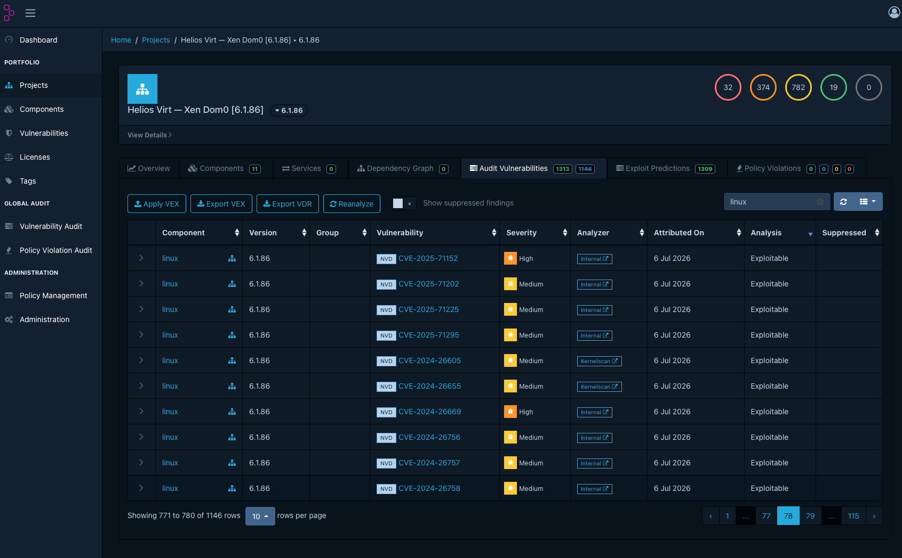
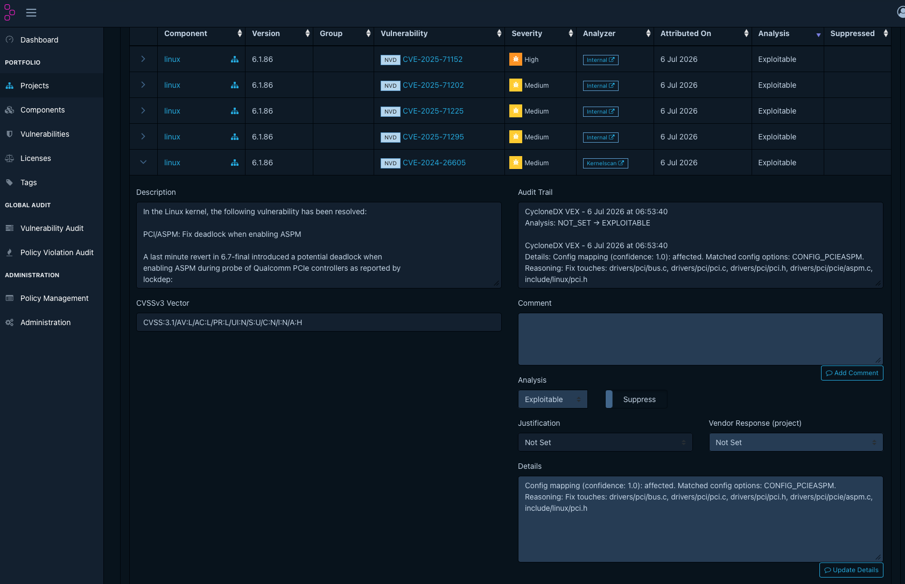

# kernelscan-dt-plugin

[](LICENSE)

A **Dependency-Track v5 vulnerability analyzer** that adds config-aware Linux
kernel CVE triage. It matches the kernel component in a project's SBOM, resolves
the corresponding KernelScan product, and reports only the CVEs that are
**reachable in that kernel's `.config`** — turning DT's config-blind NVD kernel
noise into an actionable list.

> Open-source client for the commercial [KernelScan](https://kernelscan.io)
> service. It runs in-process in your DT apiserver and is **read-only outbound**:
> it fetches verdicts from your KernelScan account and never transmits your SBOM,
> components, or findings anywhere — see [SECURITY.md](SECURITY.md).

- Registers as a first-class analyzer next to Snyk / Trivy / VulnDB (DT's plugin
  extension point) — no fork, no core changes.
- Plain `CVE-*` / `NVD` identity: findings merge with DT's own NVD records, no
  duplicates.
- Contained failures: a KernelScan outage or bad key yields "no findings from
  this analyzer", never a failed project analysis.

## What it does

DT's stock NVD analyzer matches *every* CVE for a kernel version by CPE
(config-blind). This analyzer, per kernel component:

1. reads the kernel version from the component's CPE (or purl),
2. resolves the customer's KernelScan **product** for that version + arch,
3. fetches its config-aware VEX, and
4. reports the **config-reachable** CVEs (`exploitable` / `in_triage`) as
   findings — omitting the config-gated (`not_affected`) ones.

Example (Debian-based appliance, kernel 5.15.102): NVD alone flags ~5,000 kernel
CVEs; this analyzer reports the ~1,000 reachable in the running config.

## In Dependency-Track

With the analyzer enabled and the product VEX imported, a project's kernel CVEs
are triaged in place — config-reachable ones actionable, config-gated ones
auto-marked Not Affected.



*Audit view of a Xen Dom0 appliance (kernel 6.1.86): each finding carries an
analyzer attribution and a config-aware verdict.*



*Every verdict travels with KernelScan's config-mapping justification — here the
CVE is **Exploitable** because `CONFIG_PCIEASPM` is enabled in the running
`.config` (confidence 1.0).*

> **Reading the *Analyzer* column.** Findings attributed to `kernelscan` (rather
> than DT's `internal` NVD analyzer) are KernelScan's contribution — including
> CVEs DT's NVD matching **misses**. Example: **CVE-2024-26655** appears as a
> `kernelscan` entry on all three appliances above because NVD's version data
> tracks only the mainline introduction (6.7) and misses the fix's **backport to
> the 5.15 / 6.1 / 6.6 LTS branches** — so DT's NVD analyzer never matches those
> kernels, while KernelScan's per-branch tracking (fixed in 5.15.199 / 6.1.162 /
> 6.6.122) correctly flags them. Each such finding also links straight to
> `kernelscan.io/cve/<id>` for the full CVE analysis.

## What to expect — two stages

This plugin is **stage 1** of a two-stage integration. Knowing what each stage
does (and deliberately does *not*) avoids surprises.

### Stage 1 — the analyzer (this plugin): findings, fast

- **Fast matching, including CVEs NVD lacks.** The analyzer reports the
  config-reachable kernel CVEs — *including* ones NVD has only just published,
  or hasn't scored yet, but KernelScan already tracks. Coverage NVD's CPE
  matching misses appears here, attributed to `kernelscan`.
- **No CVSS score for some of them — expected.** For a CVE where DT's NVD
  mirror has the record but **no score** (e.g. a brand-new CVE NVD hasn't scored
  yet, even though KernelScan has), DT shows the finding with **no score**. DT
  treats its own NVD mirror as authoritative and will not let an analyzer fill
  CVSS on a mirror-owned NVD record (`isUpdatableByAnalyzer("NVD") == false`).
  The finding is still there; the score stays blank until NVD — and DT's mirror
  — catch up. (For a CVE DT's mirror doesn't have *at all*, the analyzer creates
  the record **with** KernelScan's score; only the "NVD stub without a score"
  case shows blank.)
- **No verdicts / no triage.** DT v5 analyzers produce findings only — analysis
  states (`not_affected` + justification) come exclusively from VEX imports or
  CEL policies, never from an analyzer's VDR. So at stage 1 nothing is
  suppressed: every matched CVE is an active finding.

So stage 1 gives you **presence and coverage** (which kernel CVEs are
config-reachable, incl. ones NVD is behind on) — not scores or triage.

### Stage 2 — the VEX: config-aware triage

A DT v5 analyzer only ever *creates findings*: it receives the BOM, not the DT
project or its credentials, so it cannot set analysis states or push a VEX
itself. The config-aware `not_affected` + justification verdicts therefore ride
a second, **out-of-process** channel — the product VEX is uploaded to DT
(`PUT /api/v1/vex`), which applies KernelScan's triage onto the stage-1 findings,
bound by CVE id under the shared `NVD` identity.

Run that channel with the companion connector,
**[`kernelscan-dt-vex-sync`](https://github.com/kernelscan/kernelscan-dt-vex-sync)**
(open-source, Apache-2.0). It's a small container you run *beside* DT that:

- enumerates your DT projects and resolves each to its KernelScan product using
  the **same rules as this plugin** — a `kernelscan:product` binding, else a
  unique kernel version (see
  [Which product a project maps to](#which-product-a-project-maps-to)) — so the
  findings and the verdicts can never disagree about which product a project is;
- pulls that product's config-aware VEX and `PUT /api/v1/vex`-es it on a
  schedule, skipping unchanged VEX via `ETag` so it doesn't churn DT's audit trail;
- authenticates with a DT API key scoped to `VIEW_PORTFOLIO` +
  `VULNERABILITY_ANALYSIS` and your KernelScan `ks_live_…` key, both read from
  the environment (never the command line).

**Together:** a customer's kernel findings are fully triaged — the
config-reachable ones actionable, the config-gated ones auto-marked Not Affected
with KernelScan's config-mapping justification.

## Install

The apiserver launches with `-cp 'dependency-track-apiserver.jar:lib/*'`, so a
JAR mounted into `lib/` is discovered via ServiceLoader at startup.

```yaml
# docker-compose.yml — apiserver service
volumes:
  - ./plugins/kernelscan-dt-plugin.jar:/opt/owasp/dependency-track/lib/kernelscan-dt-plugin.jar:ro
```

Restart the apiserver; the analyzer appears at
`GET /api/v2/extension-points/vuln-analyzer/extensions` and in **Administration →
Analyzers**.

## Configure

`vuln-analyzer/kernelscan` config (admin UI form, rendered from the config schema):

| Field | Default | Notes |
|---|---|---|
| `enabled` | `false` | turn the analyzer on |
| `apiBaseUrl` | `https://kernelscan.io` | KernelScan API base |
| `apiKey` | — | account API key (`ks_live_…`) — like a Snyk token |
| `cacheMinutes` | `15` | in-memory TTL for a resolved product VEX |

The customer's kernels must exist as **products** in their KernelScan account —
that's where the `.config` and its verdicts live.

### Which product a project maps to

For each kernel component the analyzer resolves the KernelScan **product** to use:

1. **By kernel version** (default) — if exactly one product has that kernel
   version, it's used. No extra setup for the common one-product-per-version case.
2. **By explicit binding** — if the kernel component carries a
   `kernelscan:product` property, the analyzer uses *that* product (matched by
   **name or id**). This is required when **two products share a kernel version
   but have different `.config`** (e.g. a left/right appliance pair): version
   alone can't tell them apart, so pin each one:

   ```json
   // kernel component in the SBOM
   {
     "type": "operating-system", "name": "linux", "version": "6.6.69",
     "cpe": "cpe:2.3:o:linux:linux_kernel:6.6.69:*:*:*:*:*:*:*",
     "properties": [
       { "name": "kernelscan:product", "value": "Router-A [6.6.69]" }
     ]
   }
   ```

If several products share a version and the component has **no** binding, the
analyzer **skips that kernel and logs a warning** — it will not guess and risk
applying the wrong config's reachability verdicts.

## Build

The DT plugin API is not published to Maven Central, so the compile classpath is
extracted from the pinned apiserver image. Only Docker is required.

```bash
make libs     # extract compile classpath from ghcr.io/dependencytrack/apiserver:5.0.2
make build    # javac + jar (in eclipse-temurin:25-jdk) -> build/kernelscan-dt-plugin.jar
make test     # pure-logic unit tests (no network)
make deploy   # scp to the m2 test instance (dev only)
```

`VERSION` + `DT_VERSION` are stamped into the JAR manifest. A plugin binary
targets one DT release (`X-DependencyTrack-Version`); rebuild per DT minor.

## Compatibility

- Dependency-Track **5.0.x** (plugin API `@since 5.0.0`, CycloneDX proto v1_7).
- Java 25 (DT's baseline).

## Layout

```
src/main/java/io/kernelscan/dtplugin/
  KernelScanPlugin.java                    ServiceLoader entry (registers the analyzer)
  analyzer/
    KernelScanVulnAnalyzerFactory.java     factory + admin-UI config
    KernelScanVulnAnalyzer.java            product resolution + config-aware findings
    KernelScanVulnAnalyzerConfigV1.java    typed config
    VexModelConverter.java                 product-VEX JSON -> CycloneDX proto vuln
src/main/resources/
  META-INF/services/…Plugin                ServiceLoader registration
  …/kernel-scan-vuln-analyzer-config-v1.schema.json   config form schema
```

## License

Apache License 2.0 — see [`LICENSE`](LICENSE) and [`NOTICE`](NOTICE).
Copyright © 2026 KernelScan UG (haftungsbeschränkt). The KernelScan service
itself is commercial; this plugin is the open-source client.
